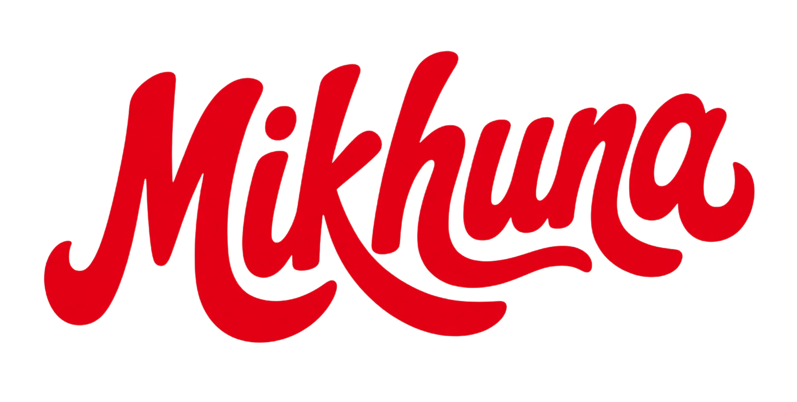
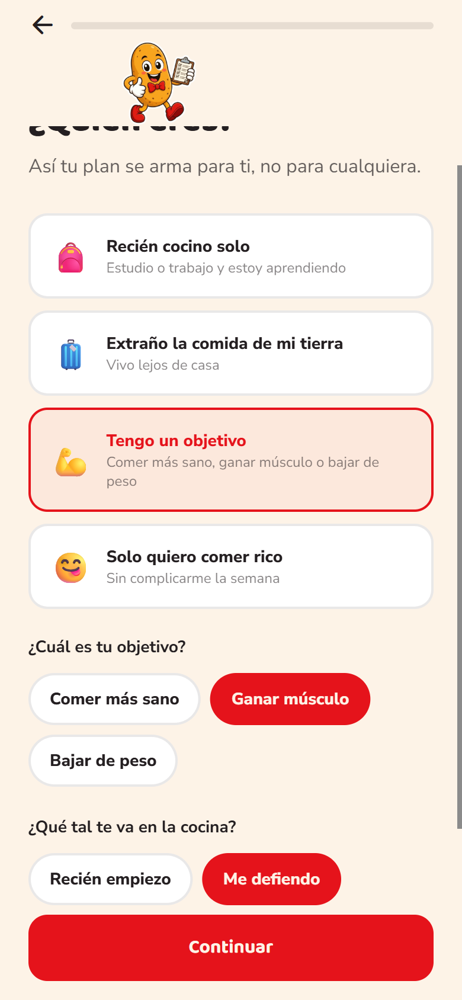
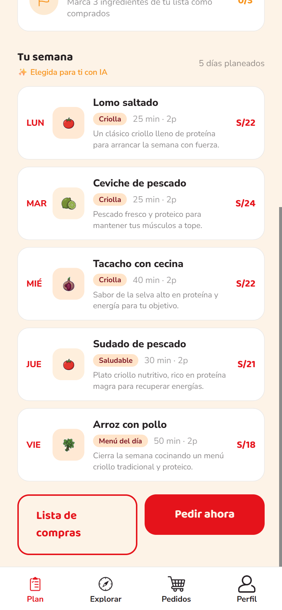
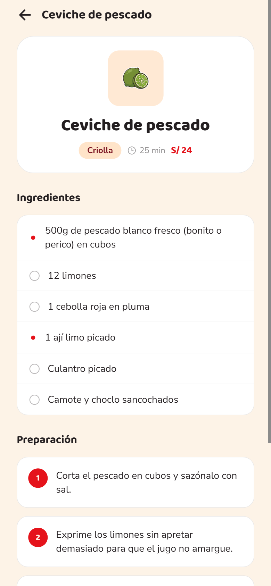
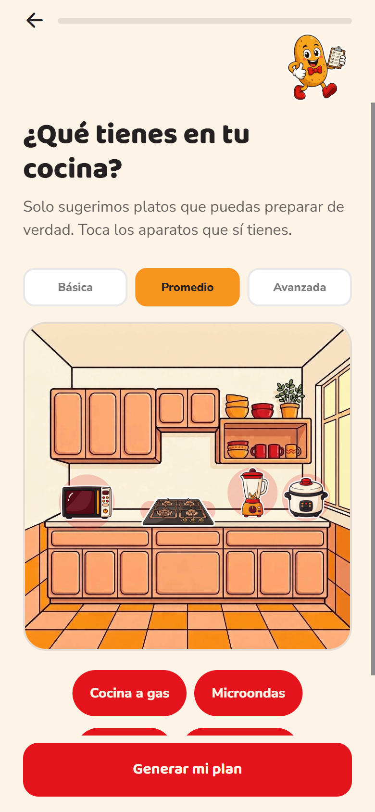
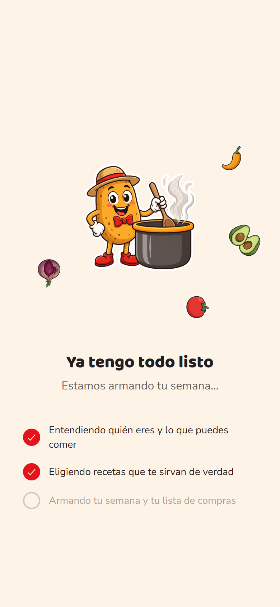
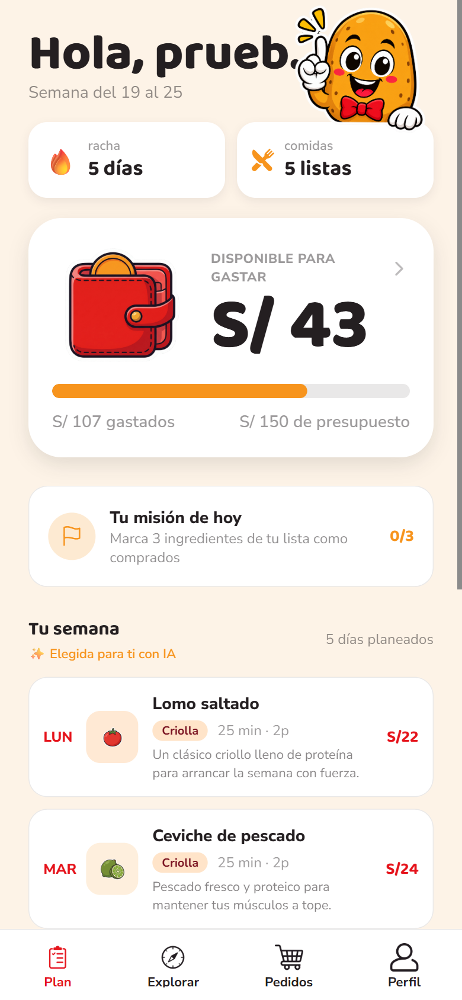
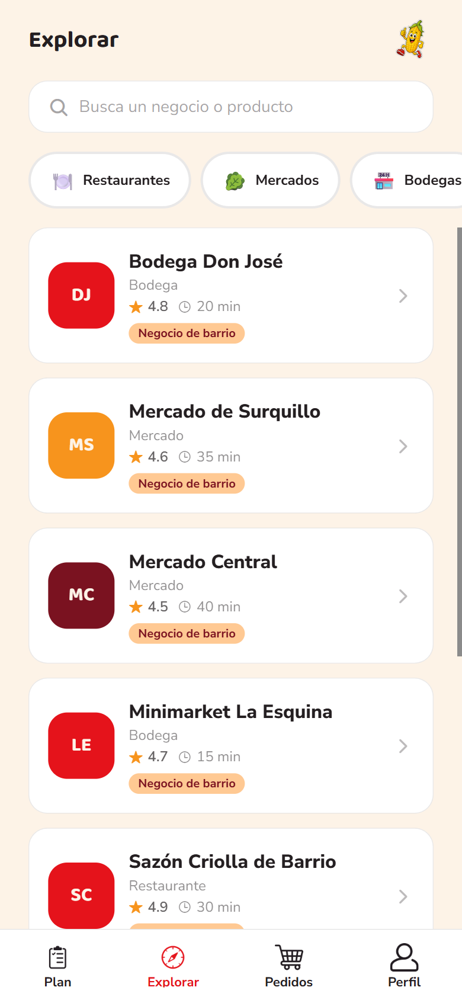

<div align="center">



### La app para quien no sabe qué cocinar 🥔🌽🐹

**Te armamos la semana según quién eres, te decimos dónde comprar cada ingrediente y, si no quieres cocinar, lo pides.**

<sub>*Mikhuna* viene del quechua y significa **"comida"**.</sub>

<br />


<br />


&nbsp;

&nbsp;


</div>

---

## 🍲 ¿Qué es Mikhuna?

Las apps de delivery parten de *"¿qué restaurante pido?"* y asumen que ya decidiste qué comer. **Mikhuna empieza un paso
antes:** *"según quién soy y lo que puedo comer, ¿qué me conviene cocinar o pedir esta semana?"*

Le cuentas quién eres, qué se te antoja, para cuántos cocinas, cuánta plata tienes y qué hay en tu cocina. Mikhuna te
arma un **plan de comidas concreto**, peruano o de otra cocina, te explica **por qué cada plato te sirve**, compara el
precio de cada ingrediente entre bodegas, mercados y supermercados y, si un día no tienes ganas de cocinar, **pides al
toque**.

### Para quién es

<table>
  <tr>
    <td align="center" width="33%">
      <br />
      <b>🎒 El que recién cocina solo</b><br />
      <sub>Estudiantes y gente que recién se independiza: recetas fáciles, sin pasos imposibles.</sub>
    </td>
    <td align="center" width="33%">
      <br />
      <b>🧳 El que extraña su tierra</b><br />
      <sub>Foráneos lejos de casa: comida de la costa, la sierra o la selva, como la de siempre.</sub>
    </td>
    <td align="center" width="33%">
      <br />
      <b>💪 El que tiene un objetivo</b><br />
      <sub>Fitness, intolerancias o dietas: "cualquier receta" no le sirve.</sub>
    </td>
  </tr>
</table>

## ✨ Lo que puedes hacer

| | |
|---|---|
| 🙋 **"¿Quién eres?"** | El plan empieza por ti: tu perfil, la comida que extrañas, tu objetivo y tu nivel en la cocina. |
| 🗓️ **Plan semanal** | Wizard de 8 pasos: quién eres, tienda, personas, días, presupuesto, antojos, restricciones y cocina. |
| 🤖 **Elegido con IA** | Gemini elige entre ~17 800 recetas reales del dataset y te dice por qué cada una te va. Nunca inventa platos ni precios. |
| ♻️ **Aprovecha lo que compras** | La semana prefiere recetas que reusan ingredientes de otros días. |
| 🔗 **Recetas parecidas** | En cada receta, otras recetas reales con los mismos ingredientes que tú puedes comer. |
| 🥗 **Respeta lo que comes** | Vegano, vegetariano, pescetariano, sin gluten o sin lactosa: lo que no puedes comer nunca aparece. |
| 🍳 **Con lo que tienes** | Si no tienes horno o licuadora, no te toca una receta que los necesite. |
| 💰 **Billetera** | Cuánto te queda de presupuesto, con una barra que pasa de verde a rojo. |
| 🛒 **Lista de compras** | Compara el precio de cada ingrediente entre tiendas o márcalo como comprado. |
| 🔎 **Explorar** | Busca negocios o productos ("pollo" encuentra el mercado que lo vende) y filtra por categoría. |
| 🛵 **Delivery** | Carrito → checkout → seguimiento en vivo con el cuy → calificación. |
| 📦 **Tus pedidos** | Historial, lo que está en camino y "Volver a pedir" con los precios de hoy. |
| 📧 **Cuenta con código** | Registro y "Olvidé mi contraseña" con un código que llega a tu correo. |
| ☁️ **En la nube** | Tu plan y tus pedidos se guardan en Supabase: cambias de celular y siguen ahí. |

<table>
  <tr>
    <td align="center"><br /><sub>¿Qué tienes en tu cocina?</sub></td>
    <td align="center"><br /><sub>Papi Papa armando tu semana</sub></td>
    <td align="center"><br /><sub>Tu billetera y tu misión</sub></td>
    <td align="center"><br /><sub>Negocios del barrio</sub></td>
  </tr>
</table>

## 🤖 Cómo funciona la IA

La IA **se basa en el dataset**: ~17 800 recetas reales extraídas de distintos sitios de cocina. No inventa platos:
recomienda a partir de esas recetas, y sus recomendaciones son coherentes con los ingredientes que cada receta ya usa.

```
Tus respuestas del wizard
        │
        ▼
1. Dataset (Supabase)     de ~17 800 recetas reales trae las que puedes comer y preparar
        │                 con lo que tienes en tu cocina → ~80, mezcladas para variar
        ▼
2. Reglas                 las revisan otra vez y ordenan según quién eres → las 20 mejores
        ▼
3. Gemini                 elige una por día SOLO de esa lista, prefiere las que reusan
        │                 ingredientes de otros días y te dice por qué cada una te sirve
        ▼
4. La app                 pone precios, cantidades y dónde comprar, desde el catálogo real
        │
        └─ ¿Gemini tarda, falla o no hay internet? Las reglas arman el plan igual.
```

**Coherente con los ingredientes**, de dos formas:

- **Tu semana aprovecha lo que compras.** Si el lunes lleva pollo y palta, otro día te toca una receta que también
  los usa, y te lo dice ("Aprovecha el pollo del lunes"). Compras una vez y no se te malogra nada.
- **Recetas parecidas.** Cada receta te muestra otras recetas reales del dataset con los mismos ingredientes,
  solo de las que tú puedes comer.

- **Nunca se salta una restricción:** `npm test` prueba todas las combinaciones de restricciones, cocinas y perfiles.
- **Rápido:** le pedimos el plan a Gemini de tres formas a la vez y usamos la primera que llega (~5 s).
- **Seguro:** la función exige una sesión real y solo acepta valores que la app puede mandar.

Detalle en [docs/IA.md](docs/IA.md) y por qué lo diseñamos así en [docs/ENFOQUE.md](docs/ENFOQUE.md).

## 📲 Descárgala y pruébala

<p>
  <a href="https://github.com/EdwardPM05/mikhuna/releases/latest/download/mikhuna.apk">
    
  </a>
</p>

1. Abre el enlace desde tu celular Android y descarga `mikhuna.apk`.
2. Ábrela. Si Android lo pide, permite "Instalar apps de origen desconocido" para tu navegador.
3. Crea tu cuenta con tu correo (te llega un código), arma tu semana y prueba las recetas parecidas.

<sub>Necesita Android 7 o superior con procesador de 64 bits (casi cualquier celular de los últimos años).
Es una versión de prueba firmada para desarrollo: Android puede avisar que no viene de Play Store.
Todas las versiones están en [Releases](https://github.com/EdwardPM05/mikhuna/releases).</sub>

## 🚀 Arráncalo

```bash
npm install
npx expo start --web      # o sin --web para Expo Go / emulador
npm test                  # pruebas de las reglas del plan
```

Crea un `.env.local` (no se sube a git):

```bash
EXPO_PUBLIC_SUPABASE_URL=...
EXPO_PUBLIC_SUPABASE_ANON_KEY=...

# opcional: entra solo en desarrollo con una cuenta de pruebas (no queda en el APK)
EXPO_PUBLIC_DEV_EMAIL=...
EXPO_PUBLIC_DEV_PASSWORD=...
```

¿Primera vez con la base de datos o la IA?

```bash
npx supabase link --project-ref lvkweyiwzkqtojlylinc
npx supabase db push                                        # tablas, RLS y límites
npx supabase functions deploy generar-plan --no-verify-jwt  # la función de IA
```

> 💡 Verlo con tamaño de celular en el navegador: [docs/LOCALHOST.md](docs/LOCALHOST.md). Sacar el APK de Android:
> [docs/COMPILACION_APK_ANDROID.md](docs/COMPILACION_APK_ANDROID.md). Correos con código: [docs/FLUJOS.md](docs/FLUJOS.md).

## 🎨 La marca

| Color | Hex | Para qué |
|---|---|---|
|  **chili** | `#E5131B` | Acciones, precios, botones |
|  **mango** | `#F7941D` | Estados, badges, íconos |
|  **peach** | `#FFC993` | Chips y resaltados suaves |
|  **cream** | `#FDF3E7` | Fondo de toda la app |
|  **maroon** | `#7A1220` | Texto sobre fondos claros |
|  **ink** | `#241F21` | Texto y contornos |

Títulos en **Baloo 2**, textos en **Nunito Sans**. Las mascotas: **Papi Papa** arma tu plan (con versiones de costa,
sierra y selva), **Choclito** te lleva a explorar y el **Cuy Delivery** te trae el pedido. Todo en
[docs/BRANDING.md](docs/BRANDING.md).

## 🧰 Stack

- **Expo SDK 57** (bare workflow, `android/` en el repo) + **expo-router** con grupos de rutas
- **NativeWind v4** — Tailwind para React Native
- **Supabase** — auth con código por correo (SMTP con Resend), tablas `planes` y `pedidos` con RLS y la Edge Function
  `generar-plan` (Deno)
- **Gemini** — elige el plan entre recetas reales, con reglas de respaldo
- **React Context** para el estado global y **TypeScript** de punta a punta

## 🗂️ Cómo está armado

```
app/                    pantallas (expo-router, agrupadas por flujo)
components/             piezas reutilizables (WizardScreen, BrandButton, CampoTexto, KitchenScene)
context/                estado global (Auth, PlanWizard, Cart, Orders)
lib/                    catálogo, cliente de Supabase, armado del plan (ia.ts), tema
supabase/functions/
  _shared/              recetas y reglas del plan, compartidas por la app y la función
  generar-plan/         Edge Function: reglas + Gemini
supabase/migrations/    tablas, RLS y límites
supabase/templates/     correos de registro y recuperación
scripts/                dataset de recetas (Python), pruebas, plantillas de correo
src/assets/             mascotas, íconos, fondos de cocina, fotos de platos
docs/                   documentación
```

## 📚 Documentación

| Doc | De qué va |
|---|---|
| [ENFOQUE](docs/ENFOQUE.md) | Qué promete Mikhuna, qué falta y por qué la IA funciona así |
| [FLUJOS](docs/FLUJOS.md) | Onboarding, cuenta, plan semanal, compras, delivery, pedidos y perfil |
| [IA](docs/IA.md) | El plan con reglas + Gemini: cómo funciona, cómo probarlo y cómo agregar recetas |
| [ARQUITECTURA](docs/ARQUITECTURA.md) | Carpetas, rutas, contexts y datos |
| [BRANDING](docs/BRANDING.md) | Colores, tipografía, mascotas y tono de voz |
| [DATASET](docs/DATASET.md) | Dataset de recetas: fuentes, limpieza y cantidades |
| [LOCALHOST](docs/LOCALHOST.md) | Correr en web, verlo como celular y problemas conocidos |
| [COMPILACION_APK_ANDROID](docs/COMPILACION_APK_ANDROID.md) | Generar el APK |
| [CHANGELOG](docs/CHANGELOG.md) | Qué cambió en cada commit y cómo regresarlo |

## 🤝 Autores

<table>
  <tr>
    <td align="center"><a href="https://github.com/AbnerGA7"><br /><b>Abner Gonzales Alcarraz</b></a></td>
    <td align="center"><a href="https://github.com/EdwardPM05"><br /><b>Edward Pittman Medina</b></a></td>
  </tr>
</table>

<div align="center">
<br />
<sub>Hecho en Perú con harto ají 🌶️</sub>
</div>
